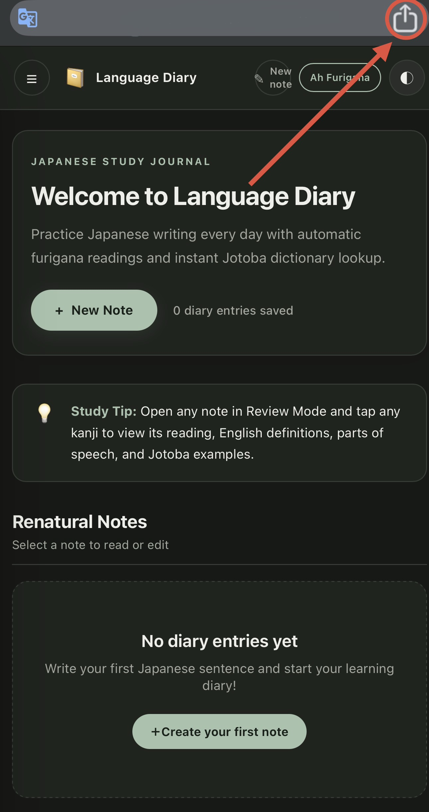
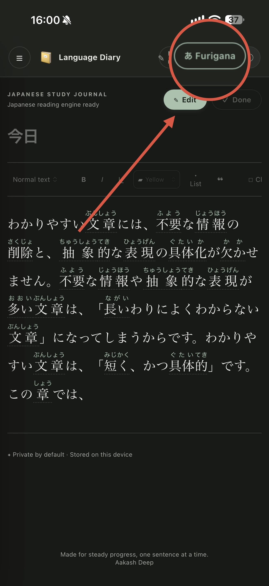
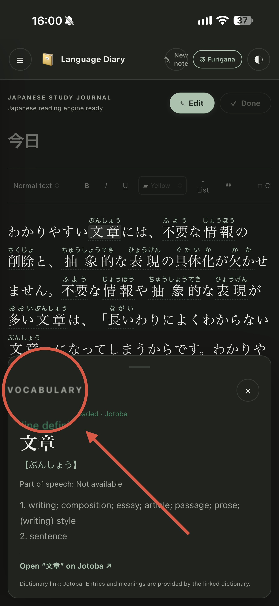

# 📖 Language Diary

**Learn Japanese naturally, one note at a time!**

Language Diary is a simple Japanese learning web app where you can write and save daily notes, learn new vocabulary, view furigana, and check Japanese word meanings using an online dictionary.

🌐 **Live App:** https://aakash-codex.github.io/Language-Diary/

---

## 📸 Screenshots

### Home Screen

### Note Editor

### Furigana
See hiragana readings above Japanese kanji to make reading easier.

### Vocabulary
Click a Japanese word to see its reading and English meaning.

---

## ✨ Features

- 📝 **Daily Notes:** Create, edit, and save Japanese diary entries.
- 📖 **Furigana:** Display hiragana readings above kanji.
- 🔍 **Online Dictionary:** Look up Japanese vocabulary and meanings.
- 💡 **Vocabulary Learning:** Check word readings, English meanings, and parts of speech.
- 🎨 **Text Formatting:** Format your notes while writing.
- 💾 **Saved Notes:** Keep your diary entries for later.
- 📱 **Responsive Design:** Use the app on mobile, tablet, and desktop.
- 🌙 **Theme:** Switch between light and dark modes.

---

## 📱 Use Language Diary on Your Mobile Phone

You can add Language Diary to your phone's home screen and open it like an app.

1. Open the [Language Diary website](https://aakash-codex.github.io/Language-Diary/).
2. Open your browser's menu or Share option.
3. Select **Add to Home Screen** or **Install App**.
4. Tap **Add** or **Install**.

That's it! You can now open Language Diary from your home screen.

---

## 🚀 How to Use

1. Open Language Diary.
2. Click **New Note** to create a diary entry.
3. Write your Japanese sentences.
4. Use furigana to help read kanji.
5. Click Japanese words to check their meanings.
6. Save your notes and continue learning every day.

---

## 🛠️ Technologies

- HTML
- CSS
- JavaScript
- Online Japanese dictionary integration

---

## 🎯 Purpose

The goal of Language Diary is to make Japanese learning easier through daily writing, vocabulary practice, and reading.

**Write every day. Learn new words. Improve your Japanese!**

---

## 👨‍💻 Developer

**AAKASH**

GitHub: [Aakash-codex](https://github.com/Aakash-codex)

Project: [Language Diary](https://aakash-codex.github.io/Language-Diary/)
## Online services and limitations

- Kuromoji's browser build and its compressed dictionary files are loaded from jsDelivr (`kuromoji@0.1.2`). This requires an internet connection.
- Full dictionary definitions open on Jotoba. The project does not call Jisho's API because its browser CORS policy can block direct requests.
- The small dictionary embedded in `app.js` is only a fallback for a few words; it is not a full dictionary.
- Notes are stored only in the current browser profile. They do not sync between devices or browsers. Clearing site data can erase them, so export/backup is a future feature to add.
- This online-first version does not yet include a service worker or offline cache. Offline support can be added after the online version is stable.

## Important privacy note

Diary text is not sent to Kuromoji or Jotoba by this app. Kuromoji processes the text in the browser. When you click **Open full definition on Jotoba**, the selected word is included in the Jotoba URL.

See `ATTRIBUTION.txt` for third-party resource credits.
